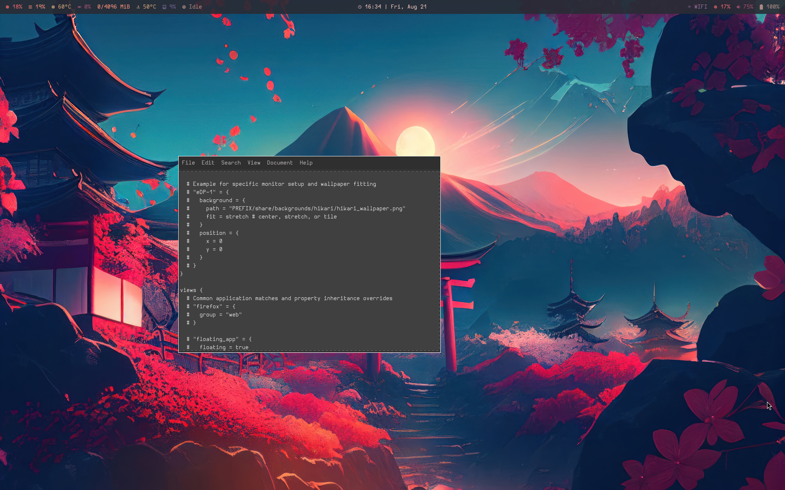

# Hikari Sakura — a Wayland desktop environment for FreeBSD



## Description

*Hikari Sakura* is a FreeBSD-focused revamp and modernization of the original
Hikari — created by `raichoo` and later carried at
<https://github.com/antaz/hikari>, which has since been abandoned upstream. It
has diverged considerably from its origin and is aimed at being the first
purpose-built Wayland desktop environment for FreeBSD rather than a compositor
alone.

It is a stacking Wayland compositor with additional tiling capabilities,
heavily inspired by the Calm Window manager (cwm(1)). Its core concepts are
*views*, *groups*, *sheets* and the *workspace*.

The workspace is the set of views that are currently visible.

A sheet is a collection of views, each view can only be a member of a single
sheet. Switching between sheets will replace the current content of the
workspace with all the views that are a member of the selected sheet. _Hikari
Sakura_ has 9 general purpose sheets that correspond to the numbers **1** to
**9** and a special purpose sheet **0**. Views that are a member of sheet **0**
will always be visible but stacked below the views of the selected sheet.

Groups are a bit more fine grained than sheets. Like sheets, groups are a
collection of views. Unlike sheets you can have a arbitrary number of groups
and each group can have an arbitrary name. Views from one group can be spread
among all available sheets. Some operations act on entire groups rather than
individual views.

Beyond window management, Hikari Sakura provides its own **top bar** and its own
**screen locker**, both themed from the same sixteen-colour palette as
everything else. The screen locker is drawn entirely in-process. The top bar is
too — the compositor renders it in its own scene graph — but its *content* comes
from `hikari-topbar`, a separate unprivileged process, so that blocking sensor
reads cannot stall the Wayland event loop. See [The top bar](#the-top-bar) and
the *Lock screen* section of hikari(1).

### Naming

**Hikari Sakura** is the name of the desktop environment as a whole. `hikari`
is the name of the compositor binary, the configuration file, the manual page
and the configuration directory — those keep the short name and are written in
lower case throughout this document and in hikari(1).

## Companion projects

Hikari Sakura is designed to be used with three sibling projects, and takes the
second half of its name from the display manager:

| Project | Written in | Role |
| --- | --- | --- |
| [**sakura**](https://github.com/orpheus497/sakura) | Zig | **The display manager.** A TUI login manager built exclusively for FreeBSD: it runs on a virtual terminal, talks to OpenPAM directly, and needs no graphical toolkit, session bus or login-manager framework. It comes first, and it is what hands the machine over to the rest. |
| [**sofi**](https://github.com/orpheus497/sofi) | C | **The shell — everything summoned rather than always present.** Control panel, application menu, sheet switcher, volume and network panes, notification daemon and history, and message toasts, from one binary. The name is an acronym: **S**akura **O**fficial **F**ull **I**ndexer. |
| [**saber**](https://github.com/orpheus497/saber) | C | **The panel — the one surface that is always there.** A persistent vertical launcher in the tradition of the Unity 7 launcher: running indicators, quicklists, application dash, window spread, system tray and session controls, in one always-present column. FreeBSD only, and written for this compositor alone. |

`sofi` and `saber` complement rather than duplicate each other, and the
difference is persistence — which decides every case between them. Every `sofi`
surface is summoned: it appears on a keypress, does one job, dismisses on
selection, and **reserves no space**, so it draws over your windows. `saber` is
on screen for the whole session and **reserves an exclusive zone**, so windows
tile beside it rather than under it — aimed at without looking, showing at a
glance what is running.

**The persistent system tray is `saber`'s.** `sofi` keeps a `-tray-daemon` for
sessions that do not run `saber`, but it draws no surface of its own — so run
one tray host, not both: exactly one process on a session bus can own
`org.kde.StatusNotifierWatcher`. See [Autostart](#autostart).

Notifications are `sofi`'s either way. The *status readout* — CPU, RAM,
temperature, network, battery, volume, media and the clock — belongs to this
compositor's own [top bar](#the-top-bar) and is duplicated by neither of them;
`sofi`'s volume and network panes are summoned **controls**, not a readout.

All three are optional — Hikari Sakura runs on its own, and any layer-shell
client (`waybar`, `wofi`, `mako`) or display manager (GDM, SDDM, greetd) works
in their place.

They are, however, what the defaults assume:

* **The shipped configuration binds four keys to `sofi`** —
  `L+Space` (application menu), `L+w` (the control panel, which is the entry
  point to every other sofi surface), `L+e` (sheet switcher) and `L+n`
  (notification history). Without `sofi` installed those four bindings do
  nothing. Either install it or rebind the corresponding `actions` entries in
  `hikari.lua`.
* **`sofi` has more surfaces than the four bound here** — volume, network, a
  key-binding reference and a window switcher (`sofi -show windowlist`) among
  them. All are reachable from the control panel on `L+w`, and any of them can
  be given a key of its own by adding an `actions` entry. The four bound by
  default are simply the ones worth a dedicated key.
* **`sofi` needs `zwlr_layer_shell_v1` at version 4**, which this compositor
  offers. Version 4 is where `on_demand` keyboard interactivity arrived, and
  `sofi`'s notification daemon relies on it to avoid stealing focus. Note the
  limitation recorded under Capabilities & Limitations above: Hikari Sakura
  currently treats `on_demand` as `exclusive`, so a toast can take the keyboard
  when it should not. `sofi` also has `xcb` and `xdg-shell` fallbacks for other
  environments; neither is used here.
* **`sofi`'s sheet switcher and `saber`'s sheet indicator are both clients of
  the compositor's control socket.** Hikari Sakura's ten-sheet-per-output model
  is not expressible in any standards-track Wayland protocol, so the compositor
  exposes it over a small Unix socket instead — see
  [The control socket](#the-control-socket).
* **The shipped configuration binds three keys to `saber`** — `LS+d` (the
  application grid), `LS+e` (the window spread) and `LS+p` (show/hide the panel
  column), each driven through `saberctl`. They are the shifted counterparts of
  the `sofi` keys above, so the two companions stay on one mental map:
  unshifted summons a `sofi` surface, shifted drives the panel that is already
  on screen. There is no binding to *start* `saber` — it is not summoned, it
  runs for the whole session. Start it from [autostart](#autostart).
* **`saber` is otherwise a plain Wayland client and patches nothing.** It lists
  and acts on windows through `wlr-foreign-toplevel-management` and places its
  surfaces with `wlr-layer-shell`, so it needs `WITH_LAYERSHELL` and
  `WITH_FOREIGN_TOPLEVEL_MANAGEMENT` — both on by default.
* **`saber` sits on two different layers, which decides what covers what.** Its
  panel is a layer-shell `TOP` surface, so a fullscreen window covers it. Its
  application grid and window spread are `OVERLAY` surfaces, which sit above
  the fullscreen band and therefore draw over a fullscreen window. Both are
  hidden by the lock screen — see Capabilities & Limitations under
  [Configuration & Customization](#configuration--customization).
* **`sakura` launches the session through whichever installed entry you pick**,
  the same as any other display manager that reads
  `${PREFIX}/share/wayland-sessions` — see [The two session entries](#the-two-session-entries).

Each project is built and installed independently; none of them requires
another at build time.

## Setting up Wayland on FreeBSD

Wayland currently requires some care to work properly on FreeBSD. This section
aims to document the recent state of how to enable Wayland on the FreeBSD
`STABLE` branch and will change once support is being improved.

### Mouse configuration

To make mice work `kern.evdev.rcpt_mask` should be set to `12`. Depending on
your version of FreeBSD this is done automatically or via setting the value in
`/etc/sysctl.conf`.

Some systems might require `moused` for mice to work. Enable it with `service
moused enable`. This requires setting `kern.evdev.rcpt_mask` to `3`.

### Setting up XDG\_RUNTIME\_DIR

Wayland compositors require `XDG_RUNTIME_DIR` to be set to a user-owned
directory with mode `0700`. Some Wayland clients (e.g. native Wayland `firefox`)
require `posix_fallocate` to work in that directory. This is not supported by
ZFS, therefore on ZFS-root systems you must ensure `/tmp` is backed by `tmpfs`:

1. Prevent the ZFS dataset from mounting over the tmpfs:

```sh
sudo zfs set canmount=noauto zroot/tmp
```

1. Add a `tmpfs` entry to `/etc/fstab` (if not already present):

```sh
tmpfs   /tmp   tmpfs   rw,mode=1777,size=256m   0   0
```

1. Reboot, then verify `/tmp` is mounted as `tmpfs`:

   ```sh
   mount | grep ' on /tmp '
   ```

   The output should show `tmpfs` as the filesystem type, for example:
   `tmpfs on /tmp (tmpfs, ...)`. A line showing `zfs` instead means `/tmp`
   is still backed by ZFS — re-check every setup step above, including the
   `/etc/fstab` entry, and make sure the system has been rebooted.

> **Note:** Without step 1, ZFS automount will mount `zroot/tmp` *over* the
> fstab tmpfs entry, and `/tmp` will still be ZFS despite the fstab line.

If your system does not set `XDG_RUNTIME_DIR` automatically (e.g. FreeBSD with
`seatd` and no `elogind`), the `start-hikari` wrapper script will create one at
`/tmp/hikari-runtime-$UID` with the correct permissions. You can also set it
manually:

```sh
export XDG_RUNTIME_DIR=/tmp/runtime-$(id -u)
mkdir -p -m 0700 "$XDG_RUNTIME_DIR"
```

### Setting up PAM

Setting up PAM is needed to give Hikari Sakura the ability to unlock the screen
when using the screen locker. `make install` does this for you, installing
`etc/pam.d/hikari-unlocker.FreeBSD` to
`${ETC_PREFIX}/etc/pam.d/hikari-unlocker`. If you are running from the source
tree without installing, copy it into place by hand:

```sh
sudo install -m 644 etc/pam.d/hikari-unlocker.FreeBSD \
    ${ETC_PREFIX}/etc/pam.d/hikari-unlocker
```

Substitute the same `ETC_PREFIX` you build with — `/usr/local` if you never set
it — so the policy lands where `hikari-unlocker` expects it.

### Setting up the keyboard layout

`hikari` natively configures its keyboards via the `inputs.keyboards` table in
`hikari.lua`. You can directly specify your `xkb` layout, options, repeat
rates, and delays there.

If a keyboard is not explicitly configured in `hikari.lua`, Hikari Sakura will
fall back to using `xkb` environment variables. To select a layout this way, set
`XKB_DEFAULT_LAYOUT` before starting Hikari Sakura.

```sh
export XKB_DEFAULT_LAYOUT="de(nodeadkeys),de"
```

## Configuration & Customization

Hikari Sakura is configured in Lua 5.4. The configuration file is a Lua chunk
that must `return` exactly one table, and that table *is* the configuration; a
chunk that returns nothing is an error that says so. It is expected to be
located at `$XDG_CONFIG_HOME/hikari/hikari.lua` — `~/.config/hikari/hikari.lua`
when `XDG_CONFIG_HOME` is unset. If it does not exist, Hikari Sakura will fall
back to the default config installed at `${ETC_PREFIX}/etc/hikari/hikari.lua`.

Because the file is a program rather than a data format, `string.format`,
`table.insert`, `math.max`, `pairs`, `ipairs`, `for` loops and local functions
are all available, and a repetitive block such as the per-sheet bindings can be
generated rather than typed. It is nevertheless loaded as text only and run in
a sandbox: `io`, `os.execute`, `require`, `load`, `pcall` and the metatable
primitives are absent, and the chunk executes under an instruction-count budget
and a memory ceiling. The line that divides the two halves is that a
configuration file may *compute* values, but it may not run commands, read
files or loop forever. The single exception is `include("other.lua")`, the
successor to libucl's `.include` — it loads another configuration file relative
to this one and *returns* its value for you to splice in, since there is no
sane in-place merge for a Lua table constructor, and a second argument of
`true` makes an unreadable file `nil` instead of an error the way
`.try_include` did.

The shipped default configuration is written as an annotated reference: every
key in it is a default made explicit, so deleting any of them changes nothing.
Read it alongside hikari(1), which is the complete reference for every section
and every action name.

`make install-user` seeds a personal copy for you — see
[Seeding a user configuration](#seeding-a-user-configuration).

The configuration file allows you to define:

- **ui**: colors, border sizes, fonts, gaps, the sixteen-colour `palette` and
  the semantic `colorscheme` derived from it, plus the `animation`, `lock` and
  `bar` subsections.
- **layout** / **layouts**: the default layout and named workspace tiling
  patterns.
- **inputs**: pointers, keyboards, switches (lid) and trackpad gestures.
- **outputs**: per-output wallpaper and position.
- **output\_management\_overrides\_config**: a single top-level `true`/`false`
  deciding whether `wlr-randr` or this file leads display configuration. See
  [Display configuration](#display-configuration).
- **views**: window matching rules (by app ID) to automatically group, float, or
  pin applications to specific sheets.
- **marks**: single-key marks that focus or spawn a given command.
- **actions**: user-defined shell commands (e.g. launching a terminal, volume
  control).
- **bindings**: keyboard and mouse shortcuts mapped to actions or internal
  operations.

**Capabilities & Limitations:**

- Environment variables are read through the global `env` table — `env.TERMINAL`
  is the value of `$TERMINAL`, and `nil` when it is unset, so
  `env.TERMINAL or "foot"` supplies a fallback. There is no substitution *into*
  strings; see [Environment](#environment).
- Structural changes like UI themes, custom actions, and new bindings can be
  hot-reloaded using the `reload` action (default: `LS+r`, that is
  Super+Shift+R — modifier letters are concatenated, so `LS+r` is one modifier
  set and there is only ever one `+`).
- Two things do not reload. The `hikari-topbar` helper is spawned once at
  startup, so `ui.palette` reaches the bar only on the next compositor
  start; and a `position` set in `outputs` re-applies on reload only when
  `output_management_overrides_config` is `false` and the value actually
  changed.
- A key written twice is neither merged nor an error, and there is **no
  warning** — this is Lua, and a table constructor keeps the **last** value
  written for a key and discards the earlier one. The collapse happens inside
  the constructor, before any of the compositor's own code is handed the table,
  so no diagnostic for it is possible even in principle. Two `palette` tables
  inside the same `ui` table are not merged; the second simply replaces the
  first. If a setting appears to do nothing, check first that you have not
  written the same key twice in the same table.
- A key written *wrong* is the opposite case and is loud. An unknown section,
  and an unknown key inside `ui`, `layout`, `outputs`, `inputs`, `views`,
  `colorscheme`, `bar`, `lock`, `animation` or `blur`, fails the load outright
  and names the offender on standard error; on a reload the running
  configuration simply stays in place. See
  [Logging and diagnostics](#logging-and-diagnostics) for how to capture that
  output under a display manager.
- Conditionals, loops and local functions *are* available within the
  configuration file, because it is a Lua chunk — what is not available is
  anything that reaches outside it, which the sandbox described under
  [Configuration & Customization](#configuration--customization) withholds.
- Some environment-level initializations (like XWayland) require a full restart
  of the compositor to apply.
- Hikari Sakura provides its own built-in status bar, described below. External
  layer-shell components such as `waybar` work alongside it if you prefer them.
- Layer-shell surfaces stack in seven bands. From back to front they are: the
  wallpaper, `BOTTOM`, ordinary windows, `TOP`, fullscreen windows, `OVERLAY`,
  and the lock screen. The consequence worth knowing is that **fullscreen sits
  between `TOP` and `OVERLAY`**: a fullscreen window covers a panel on `TOP`
  (which is where `saber`'s panel and most bars place themselves) but does not
  cover an `OVERLAY` surface (where `saber`'s application grid and window
  spread place themselves). A client chooses its own layer, so this is what
  decides whether a given surface is covered.
- The lock screen disables every one of those bands except the wallpaper, and
  disabling a band disables everything inside it. No client can put a surface
  back on screen while locked, including one mapped after the lock began.
- Focus follows the mouse, but a layer-shell surface that asks for no keyboard
  (`keyboard_interactivity none` — the setting a panel or dock normally uses)
  does not change which output is active when you hover it. Moving onto a
  window, or onto empty desktop, does. This keeps the active output and the
  keyboard from disagreeing: the two used to drift apart when you passed over a
  panel on a second monitor, after which view cycling operated on the wrong
  screen.
- `keyboard_interactivity on_demand` is currently treated as `exclusive` rather
  than as click-to-focus. A layer-shell surface that requests it is given the
  keyboard when it is focused rather than only once the user interacts with it.
  This affects panels that open keyboard-driven menus; it does not affect
  surfaces that ask for `none` or `exclusive`.

### Display configuration

Hikari Sakura implements `wlr-output-management-unstable-v1`, so display layout,
resolution, refresh rate, scale and transform can be changed at runtime with any
client that speaks it — `wlr-randr` on the command line, `kanshi` for profiles
that follow your monitors around, `wdisplays` for a graphical arrangement.

```sh
wlr-randr                                        # list outputs and their modes
wlr-randr --output DP-1 --mode 2560x1440@144
wlr-randr --output DP-1 --pos 1920,0
```

Who has the last word is yours to choose, with one top-level key:

```
output_management_overrides_config = true
```

`true`, the default, lets those clients lead. Their changes are applied, and
reloading the configuration no longer drags an output back to the `position`
written in the `outputs` table. That table still **seeds** a monitor when it
first appears, so a position you configure is applied on plug-in either way —
what
changes is whether the file keeps asserting it afterwards.

`false` puts the configuration file in charge. Clients may still *read* the
configuration — `wlr-randr` with no arguments still lists every output and every
mode it supports, which is the half of it you want when writing a config — but
anything that would change an output is refused, with the reason logged, and a
reload re-applies the configured position. Pick this if you would rather the
display layout lived in one file under version control than in whichever command
was run last.

Two limits worth knowing:

- It is **one setting for every output**, not one per output. The protocol
  answers a whole configuration with a single yes or no and offers no way to
  refuse one monitor out of several, while `wlr-randr` submits every monitor on
  every invocation — so pinning a single output individually would make every
  command fail, including ones that never touched it.
- **Switching an output off** moves that screen's windows to another output
  first, and takes it out of the layout so nothing tiles into a dark rectangle.
  Switching it back on returns it to where it was; the windows stay where they
  went, exactly as when a monitor is unplugged and replugged. A lock and unlock
  does not relight an output you switched off.

Persisting a layout across restarts is `kanshi`'s job — it speaks the same
protocol, so it works with no further setup. The `outputs` table itself
carries only wallpaper and position, not modes.

### Autostart

On startup `hikari` executes `~/.config/hikari/autostart` if that file exists
and is both readable and executable. Use it to start `saber`, `sofi`'s daemons,
a notification agent, a portal, or anything else your session needs:

```sh
#!/bin/sh
saber &
sofi -notification-daemon &
```

If you run `saber`, do **not** also run `sofi -tray-daemon`. Both claim
`org.kde.StatusNotifierWatcher`, and exactly one process on a session bus can
own it — the second to start finds the name taken and its tray stays empty.
`saber` is the one that draws a persistent tray; `sofi -tray-daemon` has no
surface of its own and exists for sessions that do not run `saber`. So run it
only if you are not running `saber`.

Notifications are unaffected either way: `sofi -notification-daemon` and
`sofi -show notification-history` should keep running whichever tray host you
choose.

`hikari -a <executable>` overrides the path for a single run.

## The top bar

Hikari Sakura draws its own top bar in the compositor's scene graph. The
content comes from `hikari-topbar`, a separate unprivileged process the
compositor spawns at startup and reads a swaybar-protocol JSON stream from over
a pipe. It is a separate process on purpose: its sensors are sampled with
blocking `popen()` calls several times a second, and running those inside the
compositor would stall the Wayland event loop on every tick. A slow or wedged
sensor costs the bar its freshness and nothing else.

The bar's height follows `ui.font`, so it scales with your font choice. Its
colours come from the compositor's `ui.palette`, passed to the helper on
its command line — which is why a palette change reaches the bar on the next
compositor start rather than on a reload.

### Blocks

| Block | Source on FreeBSD | Source on Linux | Shown when |
| --- | --- | --- | --- |
| CPU usage | `kern.cp_time` | `/proc/stat` | always |
| RAM usage | `hw.physmem`, `vm.stats.vm.*` | `/proc/meminfo` | always |
| CPU temperature | `dev.cpu.0.temperature`, falling back to `hw.acpi.thermal.tz0.temperature` | `/sys/class/hwmon`, falling back to `/sys/class/thermal` | a sensor is readable |
| GPU usage, VRAM, temperature | `nvidia-smi` | `nvidia-smi` | an NVIDIA GPU is detected at startup |
| `$HOME` partition usage | `statfs(2)` | `statfs(2)` | always |
| Media / now playing | `playerctl` | `playerctl` | always (shows `Idle` with nothing playing) |
| Network | `getifaddrs(3)` | `getifaddrs(3)`, plus `/sys/class/net` to tell Wi-Fi from Ethernet | always |
| Backlight | `backlight(8)` | `/sys/class/backlight` | a level is readable |
| Volume | `pactl` | `pactl` | a default sink is readable |
| Battery | `hw.acpi.battery.*` | `/sys/class/power_supply` | a battery is present |
| Clock and date | `strftime(3)` | `strftime(3)` | always |

The two columns are two implementations of one contract, not two feature sets:
`include/hikari/topbar_sensors.h` declares what a platform must answer and
`src/topbar_sensors_freebsd.c` and `src/topbar_sensors_linux.c` each answer it,
so a block that is absent on one platform is absent because the hardware or the
helper is missing, never because the port skipped it. The rows that name the
same source on both are the ones where no branch was needed at all.

Blocks with no readable source are omitted entirely rather than shown empty, so
a desktop with no battery and integrated graphics simply has a shorter bar.

The battery block picks its colour from the charge level, mapping onto specific
palette entries — the bands are listed in the shipped `hikari.lua`. Retheming
the palette retints the battery with it.

### Runtime dependencies

None of these are required to build or run Hikari Sakura; each one only affects
the block that uses it.

* **A Nerd Font**, installed and selected via `ui.font`. The blocks are
  labelled with private-use-area glyphs, so without one the bar renders boxes.
* `playerctl` — the media block. Without it, the block reads `Idle`.
* `pactl` (PulseAudio or PipeWire-pulse) — the volume block.
* `backlight(8)`, part of the FreeBSD base system — the backlight block.
* `nvidia-smi` — the GPU blocks. Probed once at startup; absent on
  integrated-only machines, where the GPU blocks never appear.

### Long block text

The media block's content is whatever the playing track is called and is
therefore unbounded. The `["max-block-chars"]`, `["scroll-interval"]` and
`["scroll-separator"]` keys of `ui.bar` cap it and scroll the remainder as a
banner. Those keys are read by the compositor rather than by the helper, so
they do take effect on a configuration reload. See the *bar* subsection of
hikari(1).

### Palette fallback

If `hikari-topbar` is started by hand with no palette argument, it falls back to
reading `~/.cache/wal/colors` (pywal), and to white if that is absent too. The
compositor always passes its own palette, so this path is only reached when the
helper is run standalone.

## The control socket

Hikari Sakura's sheet model — ten sheets per workspace, permanently bound to
their output — is not expressible in any standards-track Wayland protocol.
`foreign-toplevel` has no notion of a workspace, and `ext-workspace-v1`'s
`assign` moves a workspace to an output group rather than a window to a
workspace. An external sheet switcher therefore has nothing to read and nothing
to call.

The compositor supplies that missing surface as a small request/response text
socket at `$XDG_RUNTIME_DIR/hikari.sock`, mode `0600`. It reports which sheet is
displayed and how many views each sheet holds, and accepts the two operations a
switcher needs (`sheet` and `pin`). This is what `sofi -show sheets` and
`saber`'s sheet indicator speak.

It is deliberately minimal and is not a general scripting interface: anything
expressible as a Wayland protocol belongs in a Wayland protocol. Every request
is refused unless the compositor is in normal mode, so nothing reachable through
the socket can act on — or read view counts from — a locked screen.

The full protocol, including the response grammar and every error string, is
documented in the **CONTROL SOCKET** section of hikari(1).

## Laptop Optimization

When using Hikari Sakura on a laptop, especially on FreeBSD, you may want to map
your multimedia keys and handle the lid switch.

### Multimedia Keys (Volume & Brightness)

Hikari Sakura natively understands `XF86` keysyms via `xkbcommon`. The shipped
configuration binds the volume keys through `pactl` — which works wherever
PulseAudio or PipeWire is running — and brightness through FreeBSD's base-system
`backlight(8)`. On a machine with neither sound server, swap the volume actions
for FreeBSD's native `mixer(8)`:

```lua
actions = {
  ["vol-up"]      = "mixer vol +5",
  ["vol-down"]    = "mixer vol -5",
  ["vol-mute"]    = "mixer vol.mute=^",
  ["bright-up"]   = "backlight incr 5",
  ["bright-down"] = "backlight decr 5",
},

bindings = {
  keyboard = {
    ["0+XF86AudioRaiseVolume"]  = "action-vol-up",
    ["0+XF86AudioLowerVolume"]  = "action-vol-down",
    ["0+XF86AudioMute"]         = "action-vol-mute",
    ["0+XF86MonBrightnessUp"]   = "action-bright-up",
    ["0+XF86MonBrightnessDown"] = "action-bright-down",
  },
},
```

*Note: The `0+` prefix specifies that no modifier keys (like Super or Alt) are
required.*

Playback keys are bound the same way, through `playerctl`:

```lua
actions = {
  ["pause-play"] = "playerctl play-pause",
  ["media-next"] = "playerctl next",
  ["media-prev"] = "playerctl previous",
},

bindings = {
  keyboard = {
    ["0+XF86AudioPlay"]  = "action-pause-play",
    ["0+XF86AudioPause"] = "action-pause-play",
    ["0+XF86AudioNext"]  = "action-media-next",
    ["0+XF86AudioPrev"]  = "action-media-prev",
  },
},
```

### Lid Switch Handling

Hikari Sakura can natively parse switch events (like lid switches) through the
`inputs.switches` table in `hikari.lua`. You can bind these events to any
Hikari Sakura action. For example, to lock the screen when the lid closes:

```lua
inputs = {
  switches = {
    ["Control Method Lid Switch"] = "lock",
  },
},
```

However, Hikari Sakura itself does not manage suspend/resume states. On FreeBSD,
suspend is typically handled by `devd(8)` or `acpi(4)`. Ensure
`hw.acpi.lid_switch_state` is set appropriately via `sysctl` or
`/etc/sysctl.conf` to trigger a suspend (e.g. state `S3`) when the lid is
closed.

The screen locker reads the power source each time its blank timer is armed, so
the `["blank-timeout-ac"]` and `["blank-timeout-battery"]` keys of `ui.lock`
can give mains and battery sessions different blanking behaviour, and
unplugging while locked takes effect on the next keystroke.

## Touchscreen & Trackpad Gestures

Hikari Sakura natively supports touchscreens and multi-finger trackpad gestures.

Touchscreens are attached to the same output layout as the mouse cursor, and
touch input is forwarded to clients via the standard Wayland touch protocol. The
first touch point of a new touch sequence also drives Hikari Sakura's own focus,
raise, move, and resize behavior — the same as a left mouse click — so windows
can be managed by tapping and dragging directly on a touchscreen. Additional
simultaneous touch points are left for the client to interpret (e.g.
pinch-to-zoom in a PDF viewer).

Trackpad swipe, pinch, and hold gestures (via `wlr_pointer_gestures_v1`) can be
bound to Hikari Sakura actions in the `inputs.gestures` table, using keys of
the form `swipe-<direction>-<fingers>`, `pinch-<direction>-<fingers>` or
`hold-<fingers>`, where `<fingers>` is an integer from 1 to 5. A gesture that
matches a binding triggers the action instead of being forwarded to the client;
unmatched gestures are forwarded to the client. Update events are buffered until
the gesture ends (in case it turns out to match a binding); a gesture with more
than 128 update events has the excess silently dropped from what is forwarded.

```lua
inputs = {
  gestures = {
    ["swipe-left-3"]  = "workspace-cycle-next",
    ["swipe-right-3"] = "workspace-cycle-prev",
    ["pinch-in-3"]    = "view-toggle-maximize-full",
    ["hold-3"]        = "action-terminal",
  },
},
```

## Building

FreeBSD is the first-class target and Linux is a supported second-class one.
The asymmetry is deliberate and is not a staging post on the way to parity: no
change may regress FreeBSD behaviour, performance or build ergonomics; where a
portable spelling and a FreeBSD-native one are equally good the portable one
wins, because it deletes a branch; where they are *not* equally good FreeBSD
keeps the native spelling and Linux gets a branch of its own, so portability is
never bought with a FreeBSD regression; and a Linux-only defect is a bug where
a FreeBSD-only defect is an emergency. The compositor, `hikari-unlocker` and
`hikari-topbar` all build and run on Linux against wlroots 0.20.2.

The build system is BSD make on both platforms, and `Makefile` is the single
source of truth for how the project builds. GNU make cannot parse it, so a
`GNUmakefile` sits beside it carrying no build logic at all — GNU make reads
that filename in preference to `Makefile` and it does nothing but hand every
goal to `bmake`, which is what makes a bare `make` do the right thing on Linux
while leaving the FreeBSD path, where `make` already *is* bmake, untouched.
Install `bmake` from your distribution (`apt install bmake`,
`dnf install bmake`, `pacman -S bmake`); FreeBSD needs nothing.

When building directly from the repository, breaking changes might be
encountered due to the project being in its `first` stages; it is currently
considered `unstable`.

### Dependencies

**Build dependencies**

* wlroots (0.20)
* wayland (the `wayland-server` library and `wayland-scanner`)
* wayland-protocols
* pango
* cairo
* libinput
* xkbcommon
* pixman
* Lua 5.4 — the configuration language. The build probes the `lua-5.4`,
  `lua5.4`, `lua54` and `lua` pkg-config modules in that order and takes the
  first that satisfies both `>= 5.4` and `< 5.5`, because the module is spelled
  differently on FreeBSD, Debian, Fedora and Arch, and because an unconstrained
  match would happily select a Lua 5.5 that cannot compile
* evdev-proto
* epoll-shim (FreeBSD)
* pkgconf — every dependency above is located with `pkg-config`
* pandoc (needed by `make install` from a git checkout — see [Building the manpage](#building-the-manpage))

**Runtime dependencies**

* seatd — how `hikari` acquires the input and DRM privileges it needs, unless
  it is installed setuid root instead
* dbus — `start-hikari` calls `dbus-run-session`, and the `Hikari Sakura`
  session entry calls it directly. Without a session bus there are no portals
  (so no screen sharing), no system tray and no notifications
* XWayland (optional) — only for X11 clients
* The portal stack (optional) — screen sharing and screenshots for applications
  that request them through the portal. All three pieces belong together:
  * `xdg-desktop-portal` **1.17 or newer**. The version floor is not incidental:
    `sakura-portals.conf` is a `portals.conf` drop-in, and that mechanism was
    introduced in 1.17. On anything older the file is ignored, backend selection
    falls back to matching `UseIn=` against `XDG_CURRENT_DESKTOP`, and since this
    desktop reports itself as `Sakura` nothing matches — see
    [the desktop name](#the-desktop-name-and-why-screen-sharing-depends-on-it).
  * `xdg-desktop-portal-wlr` — the `wlr` backend, which is what
    `sakura-portals.conf` pins Screenshot and ScreenCast to. It is the only
    backend that can capture from a wlroots compositor.
  * `xdg-desktop-portal-gtk` — the `gtk` backend, second in that file's
    `default=wlr;gtk` preference order. It answers everything `wlr` does not
    implement: file dialogs, print, settings, email. Without it those portal
    requests go unanswered even though capture still works.
* grim (optional), and slurp with it — used by the two default screenshot
  actions: `screenclip` on `0+Print` (plain Print — select a region, which is
  the part that needs slurp) and `screenshot` on `LS+Print` (Super+Shift+Print
  — the whole screen). Rebind or remove those two `actions` entries if you do
  not want them

### Compiling and Installing

The build produces three binaries — `hikari`, `hikari-unlocker` and
`hikari-topbar` — plus the `start-hikari` wrapper script.

* `hikari-unlocker` checks credentials for unlocking the screen and is installed
  setuid root (`4555`).
* `hikari-topbar` feeds the native top bar with system telemetry. It runs as a
  separate unprivileged process (`555`) so its sensor polling cannot stall the
  compositor's event loop.
* `hikari` relies on `seatd` to gain the privileges it needs; if your setup
  requires otherwise it can also be installed setuid root — see
  ["Installing with SUID"](#installing-with-suid) below.

Simply run `make`:

```sh
make
```

All four files are installed to `${PREFIX}/bin` by `make install`, which also
installs the default configuration to `${ETC_PREFIX}/etc/hikari/hikari.lua`,
the PAM policy to `${ETC_PREFIX}/etc/pam.d/hikari-unlocker`, the manpage, the
default wallpaper, **both** wayland-session entries (`hikari.desktop` and
`hikari-sakura.desktop`) and the `sakura-portals.conf` portal backend map.

The installation destination can be configured by setting `PREFIX` (default is
`/usr/local` and does not need to be given explicitly). If you want to install
Hikari Sakura into a directory other than `/usr/local` you always should state
the `PREFIX` when issuing `make`, since this information is also used to specify
where Hikari Sakura can find the default configuration on your system and is
needed during the compilation process. To override installation paths for `etc`
specify `ETC_PREFIX`. `make uninstall` requires the same values for prefixes.

### Seeding a user configuration

`make install-user` writes a personal configuration for the invoking user. Run
it as yourself, **without** `sudo` — it writes into `$HOME`, not `DESTDIR`:

```sh
make install-user
```

It copies the default wallpaper to `~/.config/hikari/hikari_wallpaper.png` and
writes `~/.config/hikari/hikari.lua` with the wallpaper path already pointing
at that copy, so the background renders out of the box. Unlike `install`, it
never overwrites an existing `hikari.lua` — it says so and leaves yours alone.

`make uninstall-user` removes the wallpaper copy and deliberately leaves your
configuration in place.

### Optional features

**The `WITH_ALL` switch defaults to `YES`,** which turns on XWayland,
screencopy, gamma control, layer-shell, virtual input and foreign-toplevel
management. A plain `make` gives you all six, so most of the flags below exist
to turn things **off**.

`WITH_ALL` does **not** cover everything. Two switches stay off unless you name
them explicitly, and both are deliberate:

* `WITH_EXT_IMAGE_CAPTURE` — excluded because advertising the protocol makes
  screen sharing worse on hybrid-GPU hardware; see
  [below](#ext-image-copy-capture-opt-in-not-recommended-yet).
* `WITH_SUID` — not a compositor feature but an installation mode: it installs
  the `hikari` binary **setuid root** (`4555` instead of `555`) rather than
  letting it acquire what it needs through `seatd`. Requesting root privileges
  for the compositor is a decision to make on purpose, so it is never implied by
  `WITH_ALL`.

Any `WITH_*` variable given on the command line wins over `WITH_ALL`, so
features can be disabled individually:

```sh
make WITH_SCREENCOPY=NO           # everything except screencopy
make WITH_ALL=NO                  # no optional features at all
make WITH_ALL=NO WITH_XWAYLAND=YES  # XWayland only
```

Every switch accepts `NO` in any case (`no`, `No`, `NO`); any other value —
including `YES` — enables the feature.

| Flag | Default | What it does |
| --- | --- | --- |
| `WITH_XWAYLAND` | on | Runs X11 clients through XWayland. |
| `WITH_SCREENCOPY` | on | `wlr-screencopy`, used by `grim` and by screen sharing. |
| `WITH_GAMMACONTROL` | on | Gamma control, needed by tools like `redshift`. |
| `WITH_LAYERSHELL` | on | `zwlr_layer_shell_v1` — **required by `sofi` and `saber`**, and by `waybar`, `wofi` and `slurp`. |
| `WITH_VIRTUAL_INPUT` | on | Virtual keyboard and pointer, needed by applications like `wayvnc`. |
| `WITH_FOREIGN_TOPLEVEL_MANAGEMENT` | on | `wlr-foreign-toplevel-management`, which is how external taskbars — including `sofi -show window` and `saber`'s launcher — enumerate and activate windows. **Required by `saber`.** Its wlroots header declares itself unstable, so the switch exists to build without it if a future wlroots drops the protocol. |
| `WITH_EXT_IMAGE_CAPTURE` | **off** | `ext-image-copy-capture-v1`. Excluded from `WITH_ALL` on purpose — see below. |
| `WITH_SUID` | **off** | Installs `hikari` itself setuid root (`4555` instead of `555`). |

#### ext-image-copy-capture (opt-in, not recommended yet)

`ext-image-copy-capture-v1` is the successor to `wlr-screencopy`, which wlroots
documents as deprecated and intends to remove. Hikari Sakura can advertise it,
but does **not** by default — and it is deliberately excluded from `WITH_ALL`:

```sh
make WITH_EXT_IMAGE_CAPTURE=YES
```

The reason is that `xdg-desktop-portal-wlr` switches to this protocol as soon as
a compositor advertises it (it logs `wayland: using ext_image_copy_capture`), and
on hybrid-GPU hardware that path has been observed to deliver **black frames**
while `wlr-screencopy` captures correctly — so advertising it makes screen
sharing worse on machines where the older protocol works fine. `grim`, which uses
screencopy, is unaffected either way.

Enable it to re-test once your graphics stack moves on; the implementation lives
entirely inside wlroots, so nothing in this compositor needs to change.

#### Installing with SUID

If Hikari Sakura should require root privileges for startup, state `WITH_SUID=YES`
during installation.

```sh
make WITH_SUID=YES install
```

#### Building the manpage

`share/man/man1/hikari.1` is generated from `share/man/man1/hikari.md` by
[`pandoc`](http://pandoc.org/), and is **not** checked into the repository.
What that means in practice:

* `make` does not need pandoc. Building the three binaries never touches the
  manual page.
* **`make install` from a git checkout does need pandoc**, because the manual
  page is one of its prerequisites and no checkout contains it.
* **Installing from a distribution tarball does not.** `make dist` regenerates
  the page before archiving it, so the tarball carries a manual page newer than
  its source and `make install` leaves it alone.

To rebuild it deliberately — which is what to run after editing
`share/man/man1/hikari.md` — use the `doc` target, which regenerates
unconditionally:

```sh
make VERSION=1.0.0 doc
```

`VERSION` is spliced into the page's header line. `make dist VERSION=1.0.0`
runs this for you, so a release tarball's manual page always carries the version
the tarball is named for.

#### Building a DEBUG build

In the case of a crash or a bug you should build a debug version of Hikari Sakura and
try to reproduce the issue. `DEBUG=YES` builds with debug symbols, disables
optimisation, and leaves `assert()` enabled (release builds define `NDEBUG`).
Extracting a stack trace for debugging purposes is also very helpful if you are
planning to submit a bug report.

```sh
make DEBUG=YES
```

AddressSanitizer is **not** enabled by `DEBUG=YES`. It is opt-in, because ASan
interferes with the privileged operations performed before the backend
initialises. Enable it explicitly when you need it:

```sh
make DEBUG=YES ASAN=YES
```

## Launching

### The two session entries

`make install` writes two entries into `${PREFIX}/share/wayland-sessions`, so a
display manager — [`sakura`](https://github.com/orpheus497/sakura), GDM, SDDM or
greetd — offers both at the login screen:

| Shown as | File | Runs |
| --- | --- | --- |
| **Hikari** | `hikari.desktop` | `start-hikari`, the session wrapper script |
| **Hikari Sakura** | `hikari-sakura.desktop` | `dbus-run-session hikari`, the compositor binary |

Both declare `DesktopNames=Sakura`, so the desktop is reported under the same
name whichever is chosen.

**`Hikari Sakura` is the one to pick unless you need otherwise.** It starts the
compositor binary directly, with `dbus-run-session` in front of it purely to
provide the session message bus that portals, the system tray and notifications
all need. Everything else the wrapper does is either already supplied by your
login manager or is a fallback for systems that do not supply it.

**`Hikari` runs the wrapper**, which is worth having when the environment needs
setting up rather than merely inheriting — most notably on machines where the
display has to be assigned deliberately.

Neither entry is required in order to start the compositor by hand from a TTY.

### What `start-hikari` does

* Clears leaked `WAYLAND_DISPLAY` / `DISPLAY` variables
* Sets `XDG_SESSION_TYPE`, `XDG_SESSION_CLASS`, and `XDG_CURRENT_DESKTOP` /
  `XDG_SESSION_DESKTOP` to `Sakura`
* Creates `XDG_RUNTIME_DIR` if the system did not provide one
* Validates `XDG_RUNTIME_DIR` ownership (current user) and permissions (`0700`)
* Warns if `XDG_RUNTIME_DIR` resides on ZFS (incompatible with `posix_fallocate`)
* Redirects output to `$HIKARI_LOG` when that variable is set
* Resolves the `hikari` binary from the script's own directory, `$PATH`, or `./`
* Wraps execution in a D-Bus session if one is not already active

```sh
start-hikari
```

### The desktop name, and why screen sharing depends on it

The compositor identifies this desktop as `Sakura` — a single name, set by
`start-hikari` for one entry and by the compositor itself for the other, so both
paths agree. It is a single name deliberately: everything that reports the
running desktop reads `XDG_CURRENT_DESKTOP` verbatim, and a colon-separated list
is displayed as one.

That name used to carry a `:wlroots` suffix, for one reason: the portal backend
was chosen by matching this variable against the `UseIn=` field of
`xdg-desktop-portal-wlr`'s portal file, which lists `wlroots`, `sway`, `Wayfire`,
`river`, `phosh` and `Hyprland` — and no Sakura name. Without a match, screen
sharing silently found no provider.

`make install` now writes
`${PREFIX}/share/xdg-desktop-portal/sakura-portals.conf`, which names the
backends for this desktop directly and removes that coupling entirely.

**If you install the session entries without that file — or change the desktop
name without renaming it to match — screen sharing and screenshots stop working
and nothing is logged to say why.** The filename is derived from the desktop
name (`$XDG_CURRENT_DESKTOP-portals.conf`, lower-cased), so it is tied to
`DesktopNames` in both session entries and to the default the compositor sets.
Change one and all four change together.

The default configuration takes your terminal emulator from the `$TERMINAL`
environment variable, written as `env.TERMINAL or "foot"` — so exporting
`TERMINAL` selects it and `foot` is what you get if you do not.

### Logging and diagnostics

`hikari` and wlroots both log to standard error, and a session started from a
display manager usually discards it — which is why configuration errors and
crash output can seem to vanish. Set `HIKARI_LOG` to a writable file path and
`start-hikari` redirects its own descriptors there before `exec`:

```sh
HIKARI_LOG=/tmp/hikari.log start-hikari
```

The redirect is a real `exec` rather than a pipe into `tee`, so the compositor
stays the top-level process and its exit status and signal disposition are
preserved — a compositor killed by `SIGSEGV` reports as such instead of as a
clean exit. The trade-off is that output no longer echoes to the terminal while
logging.

## Files

| Path | Contents |
| --- | --- |
| `$XDG_CONFIG_HOME/hikari/hikari.lua` | User configuration. Falls back to `~/.config/hikari/hikari.lua` when `XDG_CONFIG_HOME` is unset. |
| `${ETC_PREFIX}/etc/hikari/hikari.lua` | System-wide default configuration, used when no user configuration is readable. |
| `~/.config/hikari/autostart` | Executed at startup if readable and executable. |
| `${ETC_PREFIX}/etc/pam.d/hikari-unlocker` | PAM policy used by `hikari-unlocker`. |
| `${PREFIX}/share/wayland-sessions/hikari.desktop` | Session entry shown as **Hikari**; runs `start-hikari`. |
| `${PREFIX}/share/wayland-sessions/hikari-sakura.desktop` | Session entry shown as **Hikari Sakura**; runs `dbus-run-session hikari`. |
| `${PREFIX}/share/xdg-desktop-portal/sakura-portals.conf` | Portal backend map. Required for screen sharing — see [Launching](#the-desktop-name-and-why-screen-sharing-depends-on-it). |
| `${PREFIX}/share/backgrounds/hikari/hikari_wallpaper.png` | Default wallpaper. |
| `${PREFIX}/share/man/man1/hikari.1` | Manual page, generated from `hikari.md` — see [Building the manpage](#building-the-manpage). |
| `$XDG_RUNTIME_DIR/hikari.sock` | Control socket, mode `0600`. Removed on exit. |

## Environment

| Variable | Effect |
| --- | --- |
| `XDG_RUNTIME_DIR` | Wayland socket directory. Must be user-owned and mode `0700`; `start-hikari` creates and validates it. |
| `XDG_CONFIG_HOME` | Configuration directory root. Falls back to `$HOME/.config`. |
| `TERMINAL` | Terminal emulator used by the default configuration. |
| `HIKARI_LOG` | File path for `start-hikari` to capture compositor output to. |
| `XKB_DEFAULT_LAYOUT`, `XKB_DEFAULT_MODEL`, `XKB_DEFAULT_OPTIONS`, `XKB_DEFAULT_RULES` | Fallback keyboard configuration for keyboards not configured in `hikari.lua`. Read once at startup. |
| `XDG_CURRENT_DESKTOP` | This desktop's name, `Sakura`. Exported by `start-hikari`; also set by the compositor itself (without overwriting an existing value) so the binary session entry reports the same name. |
| `XDG_SESSION_DESKTOP` | Same value, for the tools that read this one instead. |
| `DBUS_SESSION_BUS_ADDRESS` | If unset, `start-hikari` wraps the compositor in `dbus-run-session`. |

Any environment variable can also be read from `hikari.lua`, but through the
global `env` table rather than by substitution into strings: `env.HOME` is the
value of `$HOME` and `nil` when the variable is unset, which makes
`env.TERMINAL or "foot"` the idiom for a value with a fallback. The one edge
worth knowing is that a variable that is *set but empty* is an empty string,
which is truthy in Lua, so `or` does not fire for it.

There is no `$VARIABLE` or `${VARIABLE}` expansion any more, and no `$$`
escape — a Lua string is literal, so `"$HOME"`, `"${HOME}"` and `"$$HOME"` all
arrive as exactly those characters. That is a feature where the consumer is a
shell: `actions` entries are run through `/bin/sh -c`, so a `$(date ...)` or a
`${VAR}` written in one reaches the shell untouched and is expanded there.
Where you want the *compositor's* environment instead, build the string
yourself — `env.HOME .. "/Pictures"`.

`env` reads the compositor's own environment as it stood when the compositor
was executed. Reloading the configuration with `LS+r` re-reads the file inside
that same process, so it sees the same environment it saw at startup: a
variable has to be exported *before* `hikari` starts for it to have any
effect.

## Documentation

* `man hikari` — the complete reference: concepts, every action name, bindings,
  layouts, the UI/palette/colorscheme/animation/lock/bar configuration, inputs,
  outputs, and the control socket protocol.
* `etc/hikari/hikari.lua` — the annotated default configuration.
* [sofi](https://github.com/orpheus497/sofi),
  [saber](https://github.com/orpheus497/saber) and
  [sakura](https://github.com/orpheus497/sakura) document their own
  configuration in their respective repositories.

## Contributing

Please make sure you use `clang-format` with the accompanying `.clang-format`
configuration before submitting any patches.

## License

Hikari Sakura is released under the 2-clause BSD license. See [LICENSE](LICENSE).
